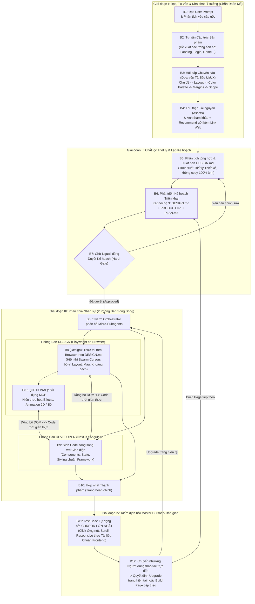
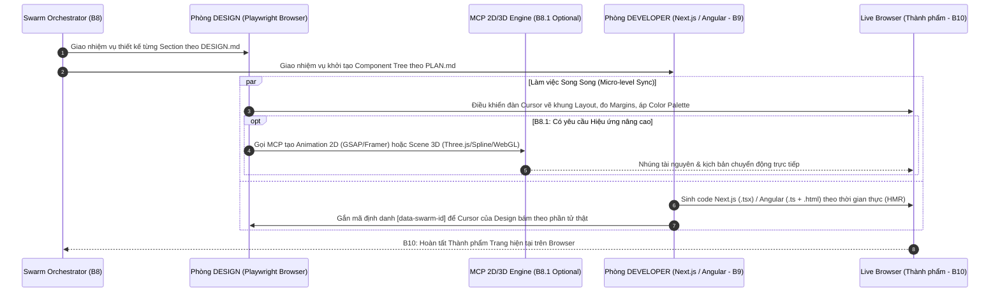

# Đề cương Nghiên cứu & Kiến trúc Hệ thống: SwarmUI — Hệ thống Đa Tác tử (Multi-Agent) Thiết kế & Xây dựng Frontend Chuẩn Product

> [!IMPORTANT]
> **Tầm nhìn nghiên cứu (Research Vision):** Giải quyết triệt để hiện tượng **"AI Slop" (Giao diện rập khuôn, thiếu thẩm mỹ kiểu AI)** và **Rào cản chuyên môn (Expertise Gap)**. Hệ thống đóng vai trò như một **Công ty Thiết kế & Phát triển Sản phẩm Thu nhỏ (Autonomous Digital Product Agency)** dành cho người không có chuyên môn lập trình hay thiết kế. Thay vì đoán mò từ 1 câu lệnh ngắn để sinh ra cả trang web sơ sài, hệ thống dẫn dắt người dùng qua **Quy trình 12 Bước chuẩn hóa**, kết tinh thành bộ 3 tài liệu sống (`DESIGN.md`, `PRODUCT.md`, `PLAN.md`), và triển khai **từng trang một (Page-by-Page)** thông qua **2 Phòng ban Subagents (Design & Developer)** chạy song song với hiệu ứng **Swarm Multi-Cursor trên trình duyệt Playwright**.

---

## Phần 1: Đặt Vấn đề & Đóng góp Cốt lõi (Problem Formulation & Contributions)

### 1.1. Ba hạn chế lớn của các công cụ AI sinh giao diện hiện nay
1. **Hội chứng "AI Slop" & Thiếu tính Khoa học trong Thiết kế:**
   - Các model hiện tại chỉ ghép các khối layout giống nhau, dùng màu sắc mặc định (tím/xanh neon của Tailwind), không có quy tắc phối màu khoa học hay tỷ lệ khoảng cách (`Margins/Padding`), khiến người xem nhận ra ngay là "web do AI tạo".
2. **Tự ý đoán mò & Không biết tư vấn cấu trúc sản phẩm:**
   - Khi người dùng không chuyên nói *"Làm cho tôi web bán hàng"*, các AI hiện tại lập tức nhả ra 1 trang giả lập sơ sài mà không phân tích cho người dùng biết một sản phẩm thực tế cần những trang nào, không hỏi sâu về tệp khách hàng, cũng không yêu cầu tài nguyên (Assets) thực tế.
3. **Sao chép máy móc khi nhận Ảnh chụp màn hình:**
   - Khi người dùng gửi ảnh tham khảo, các công cụ truyền thống cố gắng clone 100% bố cục trong ảnh thay vì chắt lọc **Triết lý thiết kế (Design Philosophy)** từ ảnh và đường dẫn (URL) gốc.

### 1.2. Đóng góp Cốt lõi của Bài nghiên cứu (Core Contributions)
- **Đóng góp 1 — Quy trình Tư vấn & Khai thác Không Đoán Mò (Zero-Guessing Consultative Elicitation - Bước 1 đến Bước 4):** Agent đóng vai trò Product Consultant phân tích hệ thống trang cần có, hỏi đáp có cấu trúc dựa trên tài liệu chuẩn về UI/UX (*Chủ đề $\rightarrow$ Layout $\rightarrow$ Color Palette $\rightarrow$ Margins $\rightarrow$ Scope*) và thu thập *Assets + Ảnh/Link tham khảo*.
- **Đóng góp 2 — Bộ Chắt lọc Triết lý Thiết kế & Trích xuất Đặc trưng Đa phương thức (Design Philosophy Distillation - Bước 5 đến Bước 7):** Từ thông tin người dùng, ảnh chụp màn hình và link trang web tham khảo (khuyến nghị gửi kèm link), hệ thống chỉ học **đặc trưng thiết kế** (không copy 100% giao diện) để biên dịch thành bộ 3 tài liệu chuẩn: **`DESIGN.md`**, **`PRODUCT.md`**, và **`PLAN.md`**.
- **Đóng góp 3 — Kiến trúc 2 Phòng Ban Song Song (Dual-Department Micro-Swarm - Bước 8 đến Bước 10):** Phân chia Subagents ở mức độ vi mô (micro-level) thành **Phòng Design** (vẽ và tương tác trực quan trên trình duyệt qua Playwright như *Swarm Rebuild*, kết hợp MCP làm hiệu ứng 2D/3D) và **Phòng Developer** (sinh code chuẩn Next.js hoặc Angular song song theo thời gian thực).
- **Đóng góp 4 — Kiểm thử Tự động bằng "Master Cursor" & Chuyển giao Trực tiếp (Master Cursor E2E Verification & Live Handover - Bước 11 & Bước 12):** Cơ chế một con trỏ tổng chỉ huy (*Cursor lớn nhất*) tự động thao tác trên từng nút bấm, cuộn trang, kiểm tra responsive theo tài liệu chuẩn Frontend trước khi trao quyền điều khiển trình duyệt cho người dùng test và nâng cấp từng trang.

---

## Phần 2: Kiến trúc Tổng thể Quy trình 12 Bước (The 12-Step Pipeline)

---

## Phần 3: Đặc tả Chi tiết Từng Bước (Step-by-Step Specification)

### Giai đoạn I: Đọc, Tư vấn & Khai thác Ý tưởng (Bước 1 $\rightarrow$ Bước 4)
> [!NOTE]
> **Nguyên tắc cốt lõi:** Tuyệt đối chặn hành vi tự đoán mò của Model. Người dùng không có chuyên môn sẽ được dẫn dắt từ khái niệm tổng quan đến chi tiết bằng ngôn ngữ trực quan, dễ hiểu.

* **Bước 1 — Đọc User Prompt & Phân tích yêu cầu khởi tạo:**
  * Hệ thống tiếp nhận ý tưởng thô ban đầu của người dùng (Ví dụ: *"Tôi muốn xây dựng một trang web bán hàng thời trang tối giản"*).
  * Nhận diện miền nghiệp vụ (Domain: E-commerce, SaaS, Portfolio, Booking...) và framework mục tiêu của dự án (**Next.js** hoặc **Angular**).
* **Bước 2 — Phân tích & Tư vấn Hệ thống Trang cho Người dùng (Product Sitemap Advisory):**
  * Vì người dùng không chuyên thường không hình dung được một sản phẩm hoàn chỉnh cần những gì, Agent sẽ phân tích và liệt kê rõ: *"Để một trang web bán hàng có thể vận hành thực tế và chuyên nghiệp, hệ thống sẽ bao gồm các trang cốt lõi sau: `Landing Page` (Trang giới thiệu thu hút), `Home / Storefront` (Trang chủ trưng bày), `Login / Register` (Đăng nhập), `Product Detail` (Chi tiết sản phẩm), `Cart & Checkout` (Giỏ hàng & Thanh toán)... Bạn muốn chúng ta bắt đầu xây dựng từ trang nào trước?"*
  * Định hình phạm vi toàn dự án nhưng chốt **xây dựng từng trang một (Page-by-Page)**.
* **Bước 3 — Hỏi đáp Khai thác Chuyên sâu dựa trên Tài liệu Chuẩn Giao diện Đẹp:**
  * Hệ thống được nạp sẵn một **Kho tri thức Thiết kế UI/UX (Design Knowledge Base)** quy định những yếu tố cấu thành một giao diện chuẩn Product.
  * Agent đặt câu hỏi từng bước (kèm gợi ý trực quan để người không chuyên dễ chọn) theo đúng chuỗi 5 trụ cột:
    1. **Chủ đề (Theme & Mood):** Phong cách chủ đạo là gì? (VD: Sang trọng tối giản kiểu *Luxury Editorial*, Hiện đại công nghệ kiểu *Linear/Apple*, hay Năng động trẻ trung?).
    2. **Bố cục (Layout Structure):** Cách sắp xếp nội dung ưu tiên điều gì? (VD: Tập trung hình ảnh lớn tràn viền, chia cột đối xứng cổ điển, hay lưới linh hoạt?).
    3. **Bảng màu khoa học (Color Palette):** Tông màu thương hiệu mong muốn và cảm giác ánh sáng (Nền sáng ấm, nền trắng tinh khiết, hay Dark Mode chiều sâu?).
    4. **Khoảng cách & Mật độ (Margins & Spatial Rhythm):** Mật độ thông tin thoáng đãng (nhiều khoảng trắng nghỉ mắt - *High Whitespace*) hay cô đọng nhiều thông tin (*Compact*)?
    5. **Phạm vi & Chân dung người dùng (Scope & Persona):** Người dùng cuối của trang này là ai (độ tuổi, thói quen) và mục đích hành động quan trọng nhất (Primary Goal) trên trang này là gì?
* **Bước 4 — Yêu cầu Tài nguyên (Assets) & Mẫu Tham khảo (Ảnh + Link):**
  * Yêu cầu người dùng cung cấp các tài nguyên thực tế của họ: Logo, hình ảnh sản phẩm, nội dung chữ cốt lõi, icon riêng (nếu có).
  * Nếu người dùng gửi **Ảnh chụp màn hình (Screenshot)** của một trang web họ thích:
    * Hệ thống lập tức đưa ra **Recommendation thông minh**: *"Bạn nên gửi kèm cả đường dẫn (URL) của trang web trong ảnh này để mình có thể đọc chính xác thông số kỹ thuật, font chữ và hiệu ứng của nó nhé!"*
    * Cam kết nguyên tắc: **Chỉ học đặc trưng thiết kế (Design DNA) bên trong ảnh/link, tuyệt đối không copy 100% bố cục giao diện gốc.**

---

### Giai đoạn II: Chắt lọc Triết lý Thiết kế & Lập Kế hoạch (Bước 5 $\rightarrow$ Bước 7)

* **Bước 5 — Phân tích Tổng hợp & Xuất bản `DESIGN.md` (Chắt lọc Triết lý Thiết kế):**
  * Từ toàn bộ câu trả lời ở Bước 3, Assets ở Bước 4, và kết quả phân tích Ảnh/URL tham khảo, Agent biên soạn tài liệu **`DESIGN.md`**.
  * **Cơ chế học đặc trưng từ Ảnh/URL (Anti-Cloning Style Extractor):**
    * Trích xuất quy luật phối màu khoa học (tỷ lệ 60% nền - 30% cấu trúc - 10% điểm nhấn trong hệ màu OKLCH), hệ thống phân cấp chữ (Typography Scale), quy chuẩn `Margins / Padding / Grid`, độ bo góc (`Border Radius`) và độ sâu bóng đổ (`Elevation`).
    * Loại bỏ hoàn toàn văn bản gốc và sơ đồ DOM gốc của trang tham khảo.
    * Đúc kết thành mục **"Triết lý Thiết kế (Design Philosophy)"** ở đầu file `DESIGN.md` (Ví dụ: *"Sự tĩnh lặng có trật tự: Sử dụng lề rộng 64px, tương phản chữ đen tuyền trên nền kem ấm, mọi nút bấm chỉ xuất hiện màu nhấn khi người dùng tương tác"*).
* **Bước 6 — Phát triển Kế hoạch Triển khai từ Bộ 3 Tài liệu (`DESIGN.md`, `PRODUCT.md`, `PLAN.md`):**
  * Hệ thống đồng bộ hóa thành 3 tài liệu trụ cột:
    1. **`DESIGN.md`**: Hiến pháp về thẩm mỹ, bảng màu khoa học, typography, margins, triết lý thiết kế và quy tắc chống "mùi AI" (Anti-AI-Slop rules).
    2. **`PRODUCT.md`**: Đặc tả nghiệp vụ sản phẩm, chân dung người dùng (Scope), sơ đồ các trang (Landing, Login, Home...), luồng dữ liệu và danh sách Assets đã thu thập.
    3. **`PLAN.md`**: Kế hoạch triển khai chi tiết cho **trang hiện tại đang được chọn xây dựng** — chia nhỏ thành từng phân vùng (Section), danh sách Component sẽ tạo trong Next.js/Angular, nhiệm vụ cụ thể của Phòng Design và Phòng Developer, cùng danh sách Test Case cho trang đó.
* **Bước 7 — Chờ Người dùng Duyệt Kế hoạch (User Approval Gate):**
  * Trình bày bản tóm tắt trực quan của `DESIGN.md`, `PRODUCT.md` và `PLAN.md` cho người dùng xem xét.
  * Hệ thống **dừng chờ phản hồi**: Chỉ khi người dùng xác nhận duyệt (Approve), quy trình mới mở khóa sang Bước 8. Nếu người dùng muốn đổi màu, đổi bố cục hay thêm bớt tính năng, hệ thống cập nhật lại tài liệu ngay tại đây.

---

### Giai đoạn III: Triển khai Vi mô Song song — Phòng Design & Phòng Developer (Bước 8 $\rightarrow$ Bước 10)

> [!TIP]
> **Điểm đột phá của Kiến trúc (Dual-Department Micro-Swarm):** Ở Bước 8 & 9, các Subagents được chia ở mức độ vi mô (micro-level) thành **2 Phòng ban hoạt động song song** và đồng bộ trực tiếp trên trình duyệt thông qua **Playwright + Swarm Multi-Cursor Overlay**.

* **Bước 8 — Phân chia Nhân sự (Micro-Subagents) & Thực thi tại Phòng DESIGN:**
  * `Swarm Orchestrator` chia nhỏ công việc của trang hiện tại cho các Subagents chuyên trách ở cấp độ vi mô (Micro-agents cho từng vùng: Header/Navbar, Hero Section, Product Grid, Interactive Form, Footer).
  * **Phòng Design (Playwright on Browser):**
    * Tuân thủ tuyệt đối triết lý thiết kế và thông số trong `DESIGN.md`.
    * Điều khiển đàn con trỏ đa màu sắc (**Swarm Cursors** lấy cảm hứng từ *Swarm Rebuild*) hoạt động trực tiếp trên cửa sổ trình duyệt Playwright: vẽ đường gióng lề (`Ruler Guides`), kéo khung bố cục, căn chỉnh `Margins/Padding`, kiểm tra độ tương phản màu sắc ngay trên giao diện đang dựng.
  * **Bước 8.1 (OPTIONAL) — Tích hợp MCP thực hiện hóa Effects & Animation 2D / 3D:**
    * Khi trang web cần điểm nhấn thị giác cao cấp (Micro-interactions, Parallax, chuyển động 2D mượt mà với GSAP/Framer Motion, hoặc mô hình/shader 3D với Three.js/React Three Fiber/WebGL), Phòng Design kích hoạt các công cụ **MCP chuyên biệt** để sinh và tinh chỉnh hiệu ứng trực tiếp trên trình duyệt.
* **Bước 9 — Thực thi tại Phòng DEVELOPER (Sinh Code Song song với Giao diện):**
  * Cùng lúc Phòng Design thao tác trên trình duyệt, các Subagents của **Phòng Developer** viết code sạch, chuẩn kiến trúc cho **Next.js** hoặc **Angular**:
    * Biến toàn bộ thông số của `DESIGN.md` thành hệ thống biến CSS / Design Tokens chuẩn.
    * Tách Component rõ ràng, gắn đầy đủ dữ liệu và Assets người dùng đã gửi ở Bước 4.
    * Nhờ cơ chế Hot Reload (HMR) kết hợp cầu nối WebSocket, mỗi dòng code Phòng Developer lưu xuống sẽ hiển thị ngay lập tức dưới mũi con trỏ của Phòng Design trên trình duyệt.
* **Bước 10 — Hợp nhất Thành phẩm (Completed Page Artifact):**
  * Hai phòng ban hoàn tất toàn bộ các phân vùng trong `PLAN.md`, tạo ra trang web hoàn chỉnh chạy thực tế trên trình duyệt địa phương (không phải ảnh tĩnh hay bản vẽ nháp).

---

### Giai đoạn IV: Kiểm định Tự động bởi "Cursor Lớn Nhất" & Chuyển nhượng Người dùng (Bước 11 $\rightarrow$ Bước 12)

* **Bước 11 — Thực thi Test Case Tự động bởi "Master Cursor" (Cursor Lớn Nhất):**
  * Sau khi đàn Cursor nhỏ của 2 phòng ban rút lui, trên màn hình trình duyệt xuất hiện **Con trỏ Tổng chỉ huy (Master QA Cursor — kích thước lớn nhất, nổi bật nhất)**.
  * Dựa trên **Tài liệu Tiêu chuẩn Xây dựng Frontend (Frontend Engineering & UX Rubric)** được cung cấp sẵn cho model cùng với Test Cases trong `PLAN.md`, `Master Cursor` sử dụng **Playwright** để thao tác thật trên toàn bộ giao diện:
    1. **Kiểm tra Tương tác từng nút một (Button-by-Button & Interactive States):** Di chuột (`hover`), bấm (`click`) vào từng nút bấm, menu, tab, ô nhập liệu để kiểm tra trạng thái `hover`, `active`, `focus`, `disabled` và đảm bảo không có nút "chết" (dead buttons).
    2. **Kiểm tra Cuộn trang & Hiệu ứng (Scroll & Viewport Choreography):** Cuộn từ đầu trang xuống cuối trang ở các tốc độ khác nhau để kiểm tra bố cục dính (`sticky header`), hiệu ứng xuất hiện khi cuộn, và phát hiện lỗi tràn khung ngang (`horizontal overflow`).
    3. **Kiểm tra Đa thiết bị (Responsive Breakpoints Testing):** Tự động thu phóng khung nhìn trình duyệt qua các kích thước Desktop (`1440px`), Laptop (`1024px`), Tablet (`768px`), và Mobile (`375px`) để đo lại `Margins`, kích thước vùng chạm (`Touch Target >= 44px`) và độ dễ đọc của chữ.
    4. **Tự động Sửa lỗi (Self-Healing Loop):** Nếu phát hiện bất kỳ điểm nào lệch khỏi `DESIGN.md` hoặc vi phạm chuẩn Frontend, `Master Cursor` khoanh vùng đỏ ngay tại phần tử đó và gọi Phòng Design + Developer sửa ngay lập tức cho đến khi vượt qua 100% Test Case.
* **Bước 12 — Chuyển nhượng Quyền điều khiển cho Người dùng & Vòng lặp Mở rộng:**
  * Khi `Master Cursor` báo cáo hoàn tất kiểm thử (`All Checks Passed`), hệ thống gỡ lớp khóa tự động và **chuyển nhượng cửa sổ trình duyệt cho người dùng trực tiếp thao tác, bấm thử và trải nghiệm**.
  * Tại đây, người dùng có 2 lựa chọn rõ ràng:
    * **Lựa chọn A (Upgrade / Tinh chỉnh trang hiện tại):** Yêu cầu chỉnh sửa chi tiết bất kỳ vị trí nào trên trang vừa dựng (quay lại Bước 8–11 rất nhanh).
    * **Lựa chọn B (Build Page tiếp theo):** Khi đã ưng ý 100% với trang hiện tại (ví dụ: đã xong `Landing Page`), người dùng chọn trang tiếp theo từ danh sách ở Bước 2 (ví dụ: `Login` hoặc `Home`). Hệ thống giữ nguyên triết lý trong `DESIGN.md` và lập `PLAN.md` mới cho trang tiếp theo để đảm bảo toàn bộ website đồng nhất tuyệt đối như một sản phẩm chuyên nghiệp.

---

## Phần 4: Cấu trúc Bộ Tài liệu Chuẩn Hóa của Hệ thống

Để quy trình 12 bước vận hành trơn tru và có tính học thuật cao, hệ thống dựa trên **4 Tài liệu Cốt lõi**:

| Tên Tài liệu | Nguồn gốc | Vai trò trong Quy trình 12 Bước |
| :--- | :--- | :--- |
| **1. `FRONTEND_STANDARDS.md`** *(Tài liệu Nền tảng)* | Cung cấp sẵn cho Hệ thống (Knowledge Base) | Dùng ở **Bước 3** (định hướng hỏi đáp về Chủ đề, Layout, Color, Margins, Scope) và **Bước 11** (làm tiêu chuẩn để *Cursor lớn nhất* chấm điểm và chạy Test Case). |
| **2. `DESIGN.md`** *(Tài liệu Thẩm mỹ)* | Sinh ra ở **Bước 5** | Chứa Triết lý thiết kế chắt lọc từ câu trả lời của User + đặc trưng Ảnh/Link tham khảo. Là kim chỉ nam cho **Phòng Design ở Bước 8**. |
| **3. `PRODUCT.md`** *(Tài liệu Sản phẩm)* | Sinh ra ở **Bước 2, 3, 4 & 6** | Lưu trữ danh sách các trang của web, chân dung người dùng (Scope), luồng nghiệp vụ và danh mục Assets người dùng đã gửi. |
| **4. `PLAN.md`** *(Kế hoạch Triển khai từng trang)* | Sinh ra ở **Bước 6**, duyệt ở **Bước 7** | Bản phân công công việc chi tiết cho từng trang giữa **Phòng Design (B8)**, **MCP 2D/3D (B8.1)**, **Phòng Developer (B9)** và kịch bản kiểm thử cho **Master Cursor (B11)**. |

---

## Bước tiếp theo (Next Steps)

Quy trình 12 bước của bạn hiện đã rất mạch lạc, chặt chẽ và tạo ra sự khác biệt rõ rệt so với mọi công cụ AI làm web hiện nay (nhờ sự kết hợp giữa **Tư vấn không đoán mò**, **Bộ 3 tài liệu `DESIGN.md` / `PRODUCT.md` / `PLAN.md`**, **2 Phòng ban Design & Dev chạy song song trên Browser**, và **Master Cursor tự động test từng nút**).

Bạn muốn chúng ta triển khai phần nào tiếp theo?
1. **Soạn thảo bộ Tài liệu Chuẩn `FRONTEND_STANDARDS.md` & Mẫu (Template) cho `DESIGN.md`, `PRODUCT.md`, `PLAN.md`** để làm bộ khung tri thức cho các Agent ở Bước 3, Bước 5, Bước 6 và Bước 11.
2. **Thiết kế chi tiết Kiến trúc Kỹ thuật của Phòng Design & Phòng Developer (Bước 8 – Bước 11)**: Cách kết nối Playwright, cách vẽ đàn Cursor nhỏ + *Cursor lớn nhất* trên trình duyệt, và cách tích hợp MCP 2D/3D.
3. **Khởi tạo Cấu trúc Dự án Thực nghiệm (Prototype)** trong thư mục làm việc để hiện thực hóa quy trình 12 bước này.
