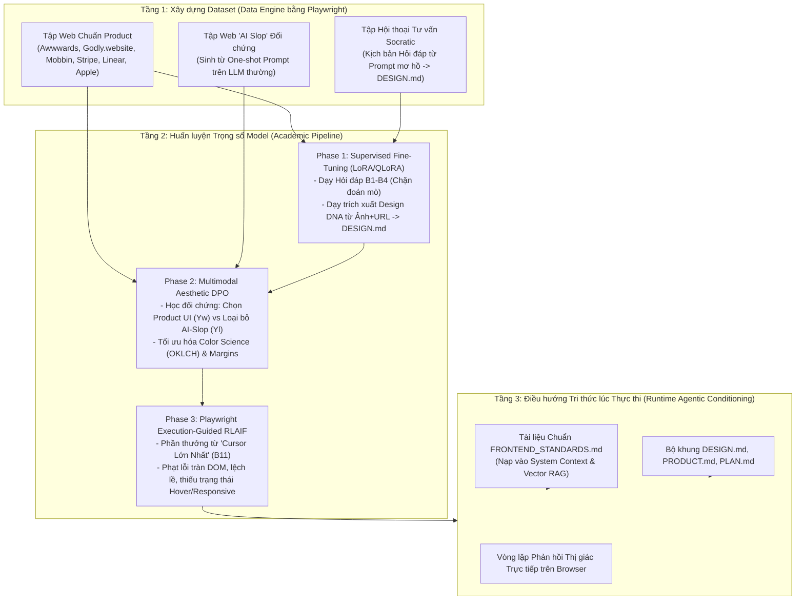

# Kế hoạch Huấn luyện & Tinh chỉnh Mô hình: SwarmUI Training & Alignment Blueprint

> [!IMPORTANT]
> **Mục tiêu kép của Kế hoạch Huấn luyện (Hybrid Strategy):**
> 1. **Về mặt Học thuật (Research Paper Value):** Đề xuất một quy trình huấn luyện mới mang tên **Aesthetic-DPO & Execution-Guided RLAIF** — dạy cho Vision-Language Model (VLM/LLM) biết cách *hỏi trước khi làm (Zero-Guessing)*, *học triết lý thay vì copy ảnh (Style-Layout Decoupling)*, và *phân biệt giao diện chuẩn Product với giao diện "mùi AI" (Anti-AI-Slop)*.
> 2. **Về mặt Thực thi Hệ thống (Practical Multi-Agent Deployment):** Kết hợp trọng số mô hình với kiến trúc **Knowledge-Grounded Agentic Conditioning** (nạp trực tiếp tài liệu chuẩn `FRONTEND_STANDARDS.md`, bộ mẫu `DESIGN.md` / `PRODUCT.md` / `PLAN.md` và bộ luật kiểm thử của Playwright).

---

## Phần 1: Tổng quan Kiến trúc Huấn luyện Lai (Hybrid Training Architecture)

---

## Phần 2: Xây dựng Bộ Dữ liệu Nghiên cứu (Dataset Curation Pipeline)

Để mô hình không bị "nhiễm" thói quen sinh code cẩu thả của các LLM đại trà, chúng ta xây dựng 3 tập dữ liệu chuyên biệt sử dụng chính **Playwright** làm công cụ thu thập tự động:

### 2.1. Tập dữ liệu 1: `Product-DNA-Corpus` (Dành cho Bước 4 & Bước 5 — Học Đặc trưng, Chống Copy)
* **Nguồn thu thập:** 500–1.000 trang web đạt giải thiết kế hoặc chuẩn SaaS/E-commerce hàng đầu (Linear, Stripe, Vercel, Apple, Aesop, Teenage Engineering, các trang trên *Godly.website* và *Awwwards*).
* **Cách Playwright trích xuất tự động:**
  * Với mỗi URL, Playwright chụp `Screenshot` toàn trang + quét toàn bộ cây DOM để rút trích `Computed Styles` (bảng màu chuyển sang hệ OKLCH, tỷ lệ `font-size`/`line-height`, ma trận `margin`/`padding`, `border-radius`, hàm `cubic-bezier`).
  * **Tạo cặp huấn luyện Chống Sao Chép (Anti-Cloning Pair):**
    * *Input:* `[Ảnh chụp trang Web A] + [Thông số CSS trích xuất từ URL A] + [Yêu cầu nghiệp vụ của ngành B khác hẳn ngành A]`.
    * *Target Output:* Bản `DESIGN.md` giữ nguyên **Triết lý thẩm mỹ của A** (cách phối màu, độ thoáng của lề, phong cách chữ) nhưng áp dụng vào **Bố cục hoàn toàn mới của ngành B**.
    * *Hàm phạt (Cloning Penalty):* Nếu độ tương đồng cấu trúc cây DOM ($\text{Tree-Edit-Distance}$) giữa trang sinh ra và trang gốc $> 60\%$, mẫu đó bị phạt nặng để ép model chỉ học "cái hồn" (Style DNA) chứ không chép bố cục.

### 2.2. Tập dữ liệu 2: `Socratic-UI-Dialogues` (Dành cho Bước 1, 2, 3 — Chặn Đoán Mò)
* **Cấu trúc mẫu dữ liệu:**
  * *User Prompt ban đầu (Cố tình mơ hồ):* `"Làm cho mình web bán giày thể thao."`
  * *Phản hồi bị cấm (Negative Response):* Sinh code HTML/React ngay lập tức.
  * *Phản hồi chuẩn (Golden Trajectory):*
    1. Phân tích hệ thống trang cần có của web bán giày (`Landing Page`, `Catalog/Home`, `Product Detail`, `Login`, `Cart`).
    2. Đặt câu hỏi khai thác 5 yếu tố (*Chủ đề $\rightarrow$ Layout $\rightarrow$ Color Palette $\rightarrow$ Margins $\rightarrow$ Scope*) bằng ngôn ngữ dành cho người không chuyên.
    3. Nhắc người dùng gửi Assets (logo, ảnh giày) và ảnh/link web mẫu họ thích.

### 2.3. Tập dữ liệu 3: `AI-Slop vs. Professional Contrastive Pairs` (Dành cho Bước 8, 9, 11)
* Với cùng một bộ tài liệu `(DESIGN.md, PRODUCT.md, PLAN.md)`, chúng ta tạo ra 2 phiên bản giao diện:
  * **Bản Thua ($y_{lose}$ - AI Slop):** Sinh bởi LLM thông thường với 1 câu lệnh (chứa đầy gradient tím-xanh lòe loẹt, 3 thẻ card giống hệt nhau, căn giữa toàn bộ, khoảng cách lộn xộn, nút bấm không có hover).
  * **Bản Thắng ($y_{win}$ - Professional Product):** Được tinh chỉnh đạt chuẩn `FRONTEND_STANDARDS.md` (phối màu 60-30-10 chuẩn OKLCH, hệ lưới 8pt nghiêm ngặt, nhịp điệu layout bất đối xứng có chủ đích, đầy đủ trạng thái tương tác).

---

## Phần 3: Quy trình 3 Giai đoạn Huấn luyện Trọng số (3-Stage Model Training)

Nếu triển khai thực nghiệm học thuật (trên các mô hình mã nguồn mở như *Qwen2.5-VL-7B/32B*, *Llama-3.2-Vision*, hoặc *DeepSeek-Coder-V2* kết hợp LoRA/QLoRA), quy trình gồm 3 pha:

### Pha 1: Supervised Fine-Tuning (SFT) — Định hình Hành vi Quy trình 12 Bước
* **Mục tiêu:** Dạy các Agent tuân thủ tuyệt đối kỷ luật của từng bước.
* **Chia thành 2 Adapter LoRA chuyên biệt:**
  1. **`Consultant-Extractor LoRA` (Phục vụ Bước 1 $\rightarrow$ Bước 6):** Huấn luyện trên tập `Socratic-UI-Dialogues` và `Product-DNA-Corpus`. Đầu ra bắt buộc là câu hỏi khai thác thông tin hoặc bộ 3 tài liệu `DESIGN.md`, `PRODUCT.md`, `PLAN.md`.
  2. **`Dual-Swarm-Coder LoRA` (Phục vụ Bước 8 $\rightarrow$ Bước 10):** Huấn luyện khả năng đọc `DESIGN.md` + `PLAN.md` để sinh ra đồng thời **Kịch bản điều khiển Cursor của Phòng Design** và **Source Code Next.js / Angular của Phòng Developer** có gắn thẻ định danh `data-swarm-id`.

### Pha 2: Multimodal Direct Preference Optimization (Aesthetic-DPO) — Khử "Mùi AI"
* **Mục tiêu:** Tinh chỉnh không gian biểu diễn của model để nó tự động "ghét" các thiết kế rập khuôn kiểu AI và ưu tiên thiết kế chuẩn Product.
* **Hàm mục tiêu DPO Đa phương thức:**
  $$\mathcal{L}_{\text{Aesthetic-DPO}}(\pi_\theta; \pi_{\text{ref}}) = -\mathbb{E}_{(x, I, y_w, y_l)} \left[ \log \sigma \left( \beta \log \frac{\pi_\theta(y_w \mid x, I)}{\pi_{\text{ref}}(y_w \mid x, I)} - \beta \log \frac{\pi_\theta(y_l \mid x, I)}{\pi_{\text{ref}}(y_l \mid x, I)} \right) \right]$$
  Trong đó:
  * $x$: Bộ tài liệu `DESIGN.md` + `PLAN.md`.
  * $I$: Ảnh chụp màn hình giao diện render thực tế trên Playwright.
  * $y_w$: Giao diện chuẩn Product (tuân thủ hệ màu khoa học & quy tắc khoảng cách).
  * $y_l$: Giao diện mắc lỗi "AI Slop".

### Pha 3: Execution-Guided RLAIF với "Master Cursor" (Bước 11 Feedback Loop)
* **Mục tiêu:** Dùng chính kết quả kiểm thử tự động của **Cursor Lớn Nhất (Master Cursor ở Bước 11)** làm hàm thưởng (Reward Function $R$) để huấn luyện/tinh chỉnh Agent:
  $$R_{\text{total}} = w_1 \cdot R_{\text{ColorHarmony}} + w_2 \cdot R_{\text{SpatialGrid}} + w_3 \cdot R_{\text{InteractiveDOM}} + w_4 \cdot R_{\text{Responsive}} - P_{\text{AISlop}} - P_{\text{Cloning}}$$
  * $R_{\text{ColorHarmony}}$: Điểm đạt chuẩn tỷ lệ 60-30-10 và độ tương phản chữ APCA đo trực tiếp trên trình duyệt.
  * $R_{\text{SpatialGrid}}$: Tỷ lệ phần trăm các giá trị `margin`/`padding`/`gap` chia hết cho hệ lưới chuẩn (`4px`/`8px`) và khớp với `DESIGN.md`.
  * $R_{\text{InteractiveDOM}}$: Tỷ lệ nút bấm/link vượt qua bài test `hover`, `click`, `focus` của `Master Cursor` trên Playwright.
  * $R_{\text{Responsive}}$: Không có thanh cuộn ngang lỗi (`scrollWidth <= clientWidth`) ở cả 4 kích thước màn hình (Desktop, Laptop, Tablet, Mobile).
  * $P_{\text{AISlop}}$: Điểm phạt nếu phát hiện các mẫu rập khuôn bị cấm trong `FRONTEND_STANDARDS.md`.

---

## Phần 4: Chiến lược Huấn luyện Ngữ cảnh Thực chiến (Agentic Context Conditioning)

Bên cạnh việc fine-tune trọng số (hoặc khi chạy trực tiếp trên các Frontier Models mạnh mẽ như Gemini / Claude / GPT thông qua API), "bộ não" của hệ thống được định hình thông qua **3 cơ chế nạp tri thức từ `FRONTEND_STANDARDS.md`**:

1. **System Prompt Partitioning theo Từng Bước (Step-Locked Conditioning):**
   * Ở **Bước 1–4**, Agent chỉ được nạp phần *Quy tắc Tư vấn Sản phẩm & Ma trận Câu hỏi Khai thác* từ `FRONTEND_STANDARDS.md` (cắt bỏ hoàn toàn quyền sinh code để chống đoán mò 100%).
   * Ở **Bước 5–6**, Agent được nạp phần *Toán học Phối màu OKLCH, Typography, Spatial Margins & Quy tắc Trích xuất Design DNA*.
   * Ở **Bước 8–9**, Phòng Design và Phòng Developer được nạp *Quy tắc Ánh xạ Next.js/Angular & Bảng Cấm AI-Slop*.
   * Ở **Bước 11**, `Master Cursor` được nạp *Bộ Kịch bản Kiểm thử DOM & Responsive*.
2. **Visual Few-Shot Exemplars (Bộ mẫu Chuẩn vs. Lỗi):**
   * Cung cấp các cặp ví dụ cụ thể (Code + Mô tả thị giác) về cách biến một yêu cầu đơn giản thành giao diện đẳng cấp thay vì giao diện AI tầm thường.
3. **Hard-Coded Playwright Ast/DOM Validators (Bộ lọc Cứng bằng Thuật toán):**
   * Không chỉ dựa vào cảm tính của LLM, mọi tiêu chuẩn về màu sắc, khoảng cách `Margins`, kích thước nút bấm đều được viết thành **hàm kiểm tra JavaScript thực thi trực tiếp trong Playwright ở Bước 11**. Nếu sai số vượt ngưỡng cho phép, code bắt buộc phải được viết lại.
