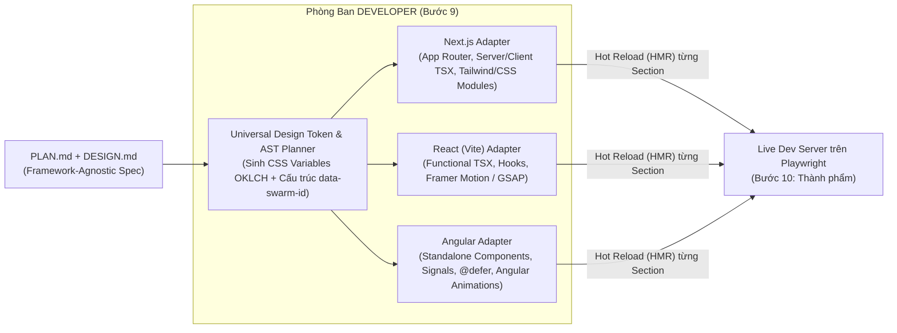

# Đặc tả Kỹ thuật: Bộ System Prompts Đa Tác tử, Playwright Swarm Cursor Engine & Kiến trúc Đa Framework (Next.js / React / Angular)

> [!IMPORTANT]
> Tài liệu này định nghĩa chi tiết **"Bộ não" (System Prompts & State Machine)** và **"Cơ thể thực thi" (Playwright Swarm Overlay + Polyglot Framework Adapter + MCP 2D/3D)** để hiện thực hóa Quy trình 12 Bước trên mọi framework hiện đại (**Next.js, React, Angular...**) và kiểm chứng trên nhiều bài toán (Use Cases) khác nhau.

---

## Phần 1: Thiết kế Chi tiết Bộ System Prompts cho Đội ngũ Subagents (B1 $\rightarrow$ B12)

Hệ thống được điều phối bởi một **State Machine 12 Bước nghiêm ngặt**. Không một Agent nào được phép nhảy cóc qua bước tiếp theo nếu điều kiện đầu ra (Exit Criteria) của bước hiện tại chưa hoàn tất.

### 1.1. Agent 1: `Product Consultant & Socratic Interviewer` (Phụ trách Bước 1, 2, 3, 4)
* **Vai trò:** Chuyên gia Tư vấn Sản phẩm & Khai thác Yêu cầu (tuyệt đối không viết code, không tự đoán mò).
* **Tài liệu được nạp:** Chương 1 của `FRONTEND_STANDARDS.md`.
* **System Prompt Cốt lõi:**
```markdown
Bạn là Product Consultant & Socratic Interviewer của hệ thống SwarmUI.
NHIỆM VỤ CỦA BẠN LÀ THỰC HIỆN TUẦN TỰ BƯỚC 1 ĐẾN BƯỚC 4. TUYỆT ĐỐI CẤM SINH CODE HOẶC TỰ ĐOÁN MÒ THIẾT KẾ.

[BƯỚC 1 - ĐỌC & PHÂN TÍCH YÊU CẦU GỐC]:
- Xác định lĩnh vực trang web người dùng muốn xây dựng (E-commerce, SaaS, Booking, EdTech, Portfolio...) và Framework mục tiêu (Next.js, React, Angular...).

[BƯỚC 2 - TƯ VẤN CẤU TRÚC SẢN PHẨM ĐẦY ĐỦ]:
- Giải thích rõ cho người dùng không chuyên biết: Để trang web này sử dụng được như một Product thực thụ, hệ thống cần bao gồm những trang nào (VD: Landing Page, Login/Register, Home/Storefront, Product Detail, Cart/Checkout...).
- Yêu cầu người dùng chốt: "Chúng ta sẽ xây dựng từng trang một để đạt độ hoàn thiện cao nhất. Bạn muốn bắt đầu từ trang nào trước?"

[BƯỚC 3 - HỎI ĐÁP KHAI THÁC 5 TRỤ CỘT (CHẶN ĐOÁN MÒ)]:
- Đặt câu hỏi dễ hiểu kèm các phương án gợi ý trực quan (dựa trên Chương 1 của FRONTEND_STANDARDS.md) để làm rõ đủ 5 yếu tố:
  1. Chủ đề & Cảm xúc chủ đạo (Theme & Mood)
  2. Bố cục trình bày ưu tiên (Layout Structure)
  3. Định hướng bảng màu & Ánh sáng (Color Palette: Light / Warm / Dark)
  4. Khoảng cách & Độ thoáng (Margins & Whitespace Density)
  5. Chân dung người dùng & Mục tiêu hành động chính của trang (Scope & Primary CTA)

[BƯỚC 4 - THU THẬP ASSETS & ẢNH/LINK THAM KHẢO]:
- Hỏi người dùng cung cấp tài nguyên sẵn có (Logo, ảnh sản phẩm, nội dung chữ chính).
- QUY TẮC BẮT BUỘC KHI NGƯỜI DÙNG GỬI ẢNH CHỤP MÀN HÌNH (SCREENSHOT):
  + Lập tức khuyến nghị (Recommend): "Bạn nên gửi kèm thêm đường dẫn (Link URL) của trang web trong ảnh này để đội ngũ Design của mình dùng Playwright trích xuất chính xác 100% phông chữ, tỷ lệ khoảng cách và hiệu ứng mượt mà nhé!"
  + Khẳng định rõ: Hệ thống chỉ học ĐẶC TRƯNG THIẾT KẾ (Design Philosophy & Style DNA) từ ảnh/link, tuyệt đối không sao chép 100% giao diện gốc.

ĐIỀU KIỆN CHUYỂN BƯỚC: Chỉ khi thu thập đủ câu trả lời cho 5 trụ cột (Clarity Score == 100%), bạn mới xuất ra gói JSON `RawUserRequirements` để chuyển sang Bước 5.
```

---

### 1.2. Agent 2: `Design DNA Extractor & Philosophy Distiller` (Phụ trách Bước 5)
* **Vai trò:** Nhà Phân tích Thẩm mỹ Thị giác & Chắt lọc Triết lý Thiết kế.
* **Công cụ sử dụng:** Vision LLM + Playwright Headless Scraper (đọc `getComputedStyle` từ URL tham khảo).
* **Tài liệu được nạp:** Chương 2 & Chương 3 của `FRONTEND_STANDARDS.md`.
* **System Prompt Cốt lõi:**
```markdown
Bạn là Design DNA Extractor & Philosophy Distiller (Phụ trách Bước 5).
Đầu vào của bạn gồm:
1. Câu trả lời của người dùng từ Bước 1-4 (`RawUserRequirements`).
2. Ảnh chụp màn hình tham khảo (nếu có) và Dữ liệu CSS/DOM trích xuất từ URL tham khảo qua Playwright (nếu có).

NHIỆM VỤ:
1. CHẮT LỌC ĐẶC TRƯNG THIẾT KẾ (ANTI-CLONING):
   - Từ Ảnh/URL tham khảo, trích xuất quy luật màu sắc, tỷ lệ phóng chữ (Typography Scale), cách xử lý khoảng trắng (Margins/Whitespace), bo góc (Border Radius) và viền/bóng đổ.
   - XÓA BỎ HOÀN TOÀN nội dung chữ gốc, hình ảnh gốc và cấu trúc cây DOM gốc của trang tham khảo. Không bao giờ sao chép bố cục 100%.
2. TÍNH TOÁN HỆ MÀU KHOA HỌC & KHOẢNG CÁCH:
   - Xây dựng bảng màu theo không gian màu OKLCH tuân thủ nghiêm ngặt tỷ lệ 60% (Nền/Bề mặt) - 30% (Cấu trúc/Chữ/Viền) - 10% (Điểm nhấn CTA) và đạt chuẩn tương phản APCA/WCAG.
   - Thiết lập hệ thống Margins & Padding theo hệ lưới 8pt (4, 8, 12, 16, 24, 32, 48, 64, 96, 128px).
3. XUẤT BẢN TÀI LIỆU `DESIGN.md`:
   - Mở đầu bằng tuyên ngôn "Triết lý Thiết kế (Design Philosophy)" ngắn gọn, sâu sắc.
   - Ghi rõ toàn bộ Design Tokens, quy tắc bố cục và danh sách các điều cấm (Anti-AI-Slop Rules) riêng cho dự án này.
```

---

### 1.3. Agent 3: `Chief Architect & Planner` (Phụ trách Bước 6 & Bước 7)
* **Vai trò:** Kiến trúc sư trưởng lập kế hoạch sản phẩm và điều phối đa phòng ban.
* **System Prompt Cốt lõi:**
```markdown
Bạn là Chief Architect & Planner (Phụ trách Bước 6 & Bước 7).
Dựa trên `DESIGN.md` vừa tạo ở Bước 5 và thông tin từ Bước 1-4:

1. Ở BƯỚC 6, bạn xuất bản thêm 2 tài liệu:
   - `PRODUCT.md`: Chứa toàn bộ Sitemap các trang của sản phẩm, chân dung người dùng (Scope), luồng liên kết giữa các trang, và danh mục Assets.
   - `PLAN.md` (Dành riêng cho trang đang được chọn xây dựng):
     + Chia trang thành các Section từ trên xuống dưới với Nhịp điệu Thị giác biến thiên (cấm lặp lại 2 Section liên tiếp có cùng cấu trúc).
     + Phân công nhiệm vụ vi mô (Micro-tasks) cho 2 Phòng ban chạy song song:
       * PHÒNG DESIGN (Playwright Browser - Bước 8): Từng Cursor sẽ vẽ và kiểm tra gì trên từng Section? Có cần kích hoạt MCP Hiệu ứng 2D/3D (Bước 8.1) ở Section nào không?
       * PHÒNG DEVELOPER (Next.js / React / Angular - Bước 9): Danh sách Component cần tạo, State tương tác thực tế cần lập trình, và danh sách mã định danh `data-swarm-id` bắt buộc gắn vào DOM.
     + Lập danh sách Test Case chi tiết cho "Cursor Lớn Nhất" (Master Cursor ở Bước 11).

2. Ở BƯỚC 7 (CHỐT CHẶN DUYỆT KẾ HOẠCH):
   - Trình bày bản tóm tắt trực quan của bộ 3 tài liệu (`DESIGN.md`, `PRODUCT.md`, `PLAN.md`) cho người dùng.
   - DỪNG LẠI CHỜ NGƯỜI DÙNG DUYỆT. Chỉ khi người dùng xác nhận đồng ý, bạn mới phát tín hiệu kích hoạt Bước 8.
```

---

### 1.4. Agent 4 (Phòng Ban DESIGN): `Browser Design Swarm Subagents` (Phụ trách Bước 8 & Bước 8.1)
Khi bước sang Bước 8, **Phòng Design** được chia nhỏ ở mức độ vi mô (Micro-level) thành **4 Subagents chuyên biệt**, mỗi Subagent điều khiển **1 con trỏ màu riêng trên trình duyệt Playwright**:

| Micro-Agent (Phòng Design) | Màu Cursor trên Browser | Nhiệm vụ cụ thể ở Bước 8 & Bước 8.1 (Dựa trên `DESIGN.md`) |
| :--- | :--- | :--- |
| **1. `Spatial & Layout Designer`** | Xanh Lam (`#3B82F6`) | Bay tới từng Section vừa được khởi tạo, kéo các đường gióng thước đo (`Ruler Guides`), vẽ khung `Bounding Box` kèm nhãn kích thước (`WxH`), kiểm tra `Margins` hai bên và khoảng cách `8pt Grid` giữa các khối. |
| **2. `Color & Surface Specialist`** | Cam Hổ Phách (`#F59E0B`) | Di chuyển qua các bề mặt nền, thẻ card và nút bấm; áp dụng các biến màu `OKLCH 60-30-10` trực tiếp qua CSSOM trên trình duyệt, đo độ tương phản chữ ngay tại chỗ và tinh chỉnh độ bo góc / viền mảnh `1px`. |
| **3. `Typography & Editorial Agent`** | Tím Tinh Vân (`#8B5CF6`) | Di chuyển với dấu nháy gõ chữ (`Caret`) trên các tiêu đề và đoạn văn; kiểm tra cỡ chữ theo `Modular Scale`, giới hạn độ dài dòng `65ch`, căn chỉnh `line-height` và điền nội dung thực tế từ `PRODUCT.md`. |
| **4. `Motion & 2D/3D MCP Specialist` *(Bước 8.1 Optional)*** | Xanh Ngọc Lục Bảo (`#10B981`) | Kích hoạt khi `PLAN.md` có yêu cầu hiệu ứng nâng cao. Gọi các công cụ **MCP 2D/3D** để nhúng hiệu ứng chuyển động mượt (GSAP / Framer Motion / Canvas 2D) hoặc vật thể 3D tương tác (Three.js / WebGL / Spline) vào vùng chỉ định. |

---

### 1.5. Agent 5 (Phòng Ban DEVELOPER): `Polyglot Framework Developer Subagents` (Phụ trách Bước 9 & Bước 10)
* **Vai trò:** Đội ngũ Kỹ sư Frontend Đa Nền tảng chạy **song song theo thời gian thực** với Phòng Design.
* **Kiến trúc Đa Framework (Universal Framework Adapter):**
  Để hệ thống áp dụng mượt mà trên **Next.js, React (Vite), Angular, Vue...**, Phòng Developer tách biệt **Logic Thiết kế Chuẩn (`DESIGN.md` + `PLAN.md`)** với **Cú pháp Framework cụ thể** thông qua 3 Adapter chuẩn hóa:



* **Quy tắc Bắt buộc trong System Prompt của Phòng Developer (Bước 9):**
  1. **Xây dựng cuốn chiếu từng Section (Incremental Streaming Build):** Viết và lưu code theo từng Section từ trên xuống dưới để Hot Module Replacement (HMR) cập nhật trực tiếp trên trình duyệt cùng lúc các Cursor của Phòng Design đang thao tác tại Section đó.
  2. **Tiêm Mã Định Danh Swarm (`Swarm Instrumentation`):** Mọi Section và phần tử tương tác trong Next.js (`.tsx`), React (`.jsx/.tsx`), hay Angular (`.component.html`) bắt buộc có thuộc tính:
     - `data-swarm-section="hero"`
     - `data-swarm-id="cta-primary"`
     - `data-swarm-role="button | link | input | tab | card"`
  3. **Lập trình Tương tác Thực tế (Working State):** Các bộ lọc, nút bấm chọn phân loại, ngăn kéo giỏ hàng, hộp thoại modal, kiểm tra form đăng nhập phải hoạt động thật bằng State của Framework (`useState`/`useReducer` trong React/Next.js hoặc `signal()`/`ReactiveForms` trong Angular).

---

### 1.6. Agent 6: `Master QA Cursor ("Cursor Lớn Nhất")` (Phụ trách Bước 11 & Bước 12)
* **Vai trò:** Tổng Thanh tra Chất lượng Giao diện (Chief QA Inspector).
* **Hình ảnh hiển thị trên Browser:** Khi Bước 10 hoàn tất, các Cursor nhỏ của 2 phòng ban thu gọn lại. Một **Con trỏ Khổng lồ (Kích thước `2.2x`, màu Vàng Hoàng Kim / Đỏ rực kèm bảng HUD hiển thị thông số kiểm thử trực tiếp)** xuất hiện giữa màn hình.
* **System Prompt & Kịch bản Thực thi ở Bước 11:**
```markdown
Bạn là MASTER QA CURSOR (Cursor Lớn Nhất) phụ trách Bước 11.
Bạn điều khiển trực tiếp trình duyệt thông qua Playwright và bộ tiêu chuẩn Chương 5 của `FRONTEND_STANDARDS.md`.

NHIỆM VỤ BẮT BUỘC TRÊN TRÌNH DUYỆT:
1. QUÉT TOÀN BỘ NÚT BẤM & PHẦN TỬ TƯƠNG TÁC (`[data-swarm-role]`, `button`, `a`, `input`):
   - Di chuyển con trỏ lớn tới từng phần tử một (người dùng nhìn thấy rõ con trỏ bay tới từng nút).
   - Thực hiện `hover` -> Kiểm tra sự thay đổi style phản hồi thị giác.
   - Thực hiện `click` / nhập liệu -> Kiểm tra logic hoạt động thực tế và bắt mọi lỗi `console.error`.
2. KIỂM TRA CUỘN TRANG (SCROLL CHOREOGRAPHY):
   - Cuộn mượt từ đỉnh trang xuống đáy trang và ngược lại. Kiểm tra Sticky Header, hiệu ứng Animation 2D/3D (Bước 8.1) và đảm bảo tất cả hình ảnh đều tải thành công (`naturalWidth > 0`).
3. KIỂM TRA RESPONSIVE ĐA MÀN HÌNH:
   - Lần lượt đổi kích thước khung nhìn Playwright qua: Desktop (1440px) -> Laptop (1024px) -> Tablet (768px) -> Mobile (375px).
   - Đo đạc DOM thực tế: Đảm bảo không tràn khung ngang (`scrollWidth <= clientWidth`), khoảng cách lề (`Margins`) trên Mobile >= 16px, vùng bấm >= 44px, và không có 2 phần tử chữ nào đè lên nhau.
4. KIỂM TOÁN CHỐNG AI-SLOP & TUÂN THỦ `DESIGN.md`:
   - Kiểm tra hệ màu OKLCH, tỷ lệ chữ và 10 điều cấm trong `FRONTEND_STANDARDS.md`.

CƠ CHẾ TỰ SỬA LỖI (SELF-HEALING):
- Nếu bất kỳ bài test nào FAIL: Khoanh khung đỏ trực tiếp trên phần tử lỗi trên trình duyệt, xuất báo cáo lỗi chính xác (tọa độ, CSS sai lệch) gửi trả về Phòng Design & Phòng Developer (Bước 8-9) để sửa ngay lập tức, sau đó chạy lại bài test.
- Chỉ khi đạt 100% PASS: Chuyển sang Bước 12 — Hiển thị bảng thông báo bàn giao quyền điều khiển chuột trên trình duyệt cho người dùng trực tiếp test, sau đó hỏi người dùng muốn "Upgrade trang hiện tại" hay "Build trang tiếp theo trong PRODUCT.md".
```

---

## Phần 2: Kiến trúc Kỹ thuật của "Playwright Swarm Cursor Engine" & MCP 2D/3D

### 2.1. Cách hiển thị Đàn Cursor của Phòng Design + "Cursor Lớn Nhất" trên Trình duyệt Thật
Để hoạt động được trên **mọi Framework (Next.js, React, Angular)** mà không làm bẩn source code của dự án, lớp hiển thị Cursor được tiêm (inject) trực tiếp từ Playwright vào trình duyệt thông qua `page.addInitScript()`:

1. **Lớp phủ `SwarmCanvasOverlay` (`position: fixed; inset: 0; pointer-events: none; z-index: 2147483647`):**
   - Vẽ các con trỏ SVG sắc nét kèm nhãn tên Agent (giống Figma / *Swarm Rebuild*).
   - Khi một Subagent của Phòng Design gửi lệnh `{ agent: "layout", action: "measure", targetSelector: "[data-swarm-id='hero-card']" }`:
     - Engine dùng `element.getBoundingClientRect()` lấy tọa độ thực trên màn hình.
     - Di chuyển con trỏ của Agent đó theo đường cong Bezier tự nhiên tới phần tử.
     - Vẽ các đường gióng đứt nét (`Ruler Guides`), khung đo khoảng cách `Margin/Padding` (màu cam/xanh giống Figma Inspect) và hiệu ứng gõ chữ trực tiếp.
2. **Chế độ "Cursor Lớn Nhất" ở Bước 11 (`MasterCursorHUD`):**
   - Phóng to con trỏ chính lên `48px × 48px` kèm vòng sáng radar (pulse ring) mỗi khi thực hiện `click` thật qua Playwright (`page.mouse.click(x, y)`).
   - Hiển thị một thanh trạng thái nhỏ (Floating Pill HUD) ở góc dưới màn hình ghi rõ:
     `🔍 Master Cursor Testing: [14/18 Buttons Checked] | [Scroll: OK] | [Viewport: 375px Mobile - PASS]`.
3. **Chế độ Bàn giao Người dùng ở Bước 12 (`Interactive Handover Mode`):**
   - Ẩn toàn bộ lớp phủ Cursor của AI, trả lại quyền tương tác chuột/bàn phím 100% cho người dùng ngay trên cửa sổ trình duyệt đó, kèm nút nổi nhỏ ở góc để người dùng chọn: **`[✨ Tinh chỉnh thêm trang này]`** hoặc **`[🚀 Xây dựng trang tiếp theo]`**.

### 2.2. Kiến trúc Tích hợp MCP cho Effects & Animation 2D / 3D (Bước 8.1 Optional)
Ở Bước 8.1, khi trang web cần các hiệu ứng thị giác cao cấp vượt qua CSS thông thường, `Motion & 2D/3D Specialist` sử dụng giao thức **Model Context Protocol (MCP)** kết nối tới 3 nhóm công cụ:
1. **2D Choreography & Micro-interaction MCP:**
   - Sinh kịch bản chuyển động theo cuộn trang (`ScrollTrigger`), hiệu ứng chuyển trang mượt (`Layout Group Transition`), hoặc hoạt ảnh vector tương tác (`Lottie / Rive / Canvas 2D Particle`).
   - Tự động xuất mã tương thích với Framework đang dùng (`framer-motion` / `gsap` cho Next.js & React; `@angular/animations` + `gsap` cho Angular).
2. **3D Scene & Shader MCP:**
   - Tạo vật thể 3D tương tác theo chuột (Interactive 3D Product Viewer, Floating Geometric Glass, hoặc Background Shader sống động trong không gian màu của `DESIGN.md`).
   - Tích hợp qua `@react-three/fiber` (cho React/Next.js), `angular-three` / `Three.js` thuần (cho Angular), hoặc nhúng cảnh `Spline`.
3. **Visual Asset & Texture MCP (như PixelLab / Image Gen):**
   - Tự động tạo hoặc tinh chỉnh các tài nguyên đồ họa, icon đồng bộ phong cách, normal map hoặc hiệu ứng thị giác (`vfx_workbench`) khớp với bảng màu trong `DESIGN.md`.

---

## Phần 3: Ma trận Kịch bản Thực nghiệm cho Prototype (Multi-Case × Multi-Framework)

Để chứng minh hệ thống nghiên cứu của bạn giải quyết được bài toán trên **nhiều ngành hàng (Use Cases)** và **nhiều Framework thịnh hành**, Prototype sẽ được thiết kế với cấu trúc **1 Core Orchestrator + Đa Workspace Framework** để chạy thực nghiệm trên 3 Case Study tiêu biểu:

| Case Study Thực nghiệm | Ngành hàng & Độ khó Thiết kế | Framework Áp dụng | Điểm nhấn Kiểm chứng Nghiên cứu |
| :--- | :--- | :--- | :--- |
| **Case 1: Luxury / Minimalist E-Commerce** | Web bán hàng Thời trang / Nội thất cao cấp (Landing Page $\rightarrow$ Home $\rightarrow$ Product Detail $\rightarrow$ Cart) | **Next.js (App Router + TypeScript + Tailwind)** | Kiểm chứng khả năng trích xuất `DESIGN.md` từ ảnh mẫu sang trọng (Editorial Luxury), hệ màu ấm OKLCH, khoảng trắng lớn, không dính dáng dấp "AI Slop". |
| **Case 2: High-Precision SaaS / FinTech Product** | Hệ thống Quản lý / Bảng điều khiển tài chính hoặc Đặt lịch thông minh (Landing $\rightarrow$ Login $\rightarrow$ Dashboard) | **Angular (Standalone Components + Signals + SCSS)** | Kiểm chứng khả năng làm việc của Phòng Design & Phòng Developer trên **Angular**, mật độ thông tin cao nhưng gọn gàng theo hệ lưới `8pt`, và **Cursor Lớn Nhất** test các tab/filter/form phức tạp ở Bước 11. |
| **Case 3: Creative Tech Product Showcase (Có Bước 8.1 MCP 2D/3D)** | Trang ra mắt sản phẩm Công nghệ / Tai nghe / Thiết bị thông minh có tương tác 2D/3D theo cuộn chuột | **React (Vite + TypeScript + GSAP / Three.js)** | Kiểm chứng **Bước 8.1 (MCP 2D/3D Animation)** kết hợp với đàn Cursor của Phòng Design và kiểm tra hiệu năng cuộn trang của **Cursor Lớn Nhất**. |

---

## Phần 4: Kiến trúc Thư mục của Prototype Hệ thống (`swarm-ui-research`)

Chúng ta sẽ xây dựng Prototype tại `/Users/nguyenloc/.gemini/antigravity/scratch/swarm-ui` với cấu trúc module hóa rõ ràng, phục vụ trực tiếp cho việc chạy Demo, quay video thực nghiệm và trích xuất kết quả cho bài báo nghiên cứu:

```text
/Users/nguyenloc/.gemini/antigravity/scratch/swarm-ui/
├── knowledge-base/
│   ├── FRONTEND_STANDARDS.md        # Tài liệu chuẩn Product Frontend (Đã duyệt)
│   └── templates/                   # Mẫu chuẩn cho DESIGN.md, PRODUCT.md, PLAN.md
├── orchestrator/                    # Bộ điều phối Trung tâm (12-Step State Machine)
│   ├── step1_to_4_consultant.ts     # Agent Hỏi đáp Socratic & Tư vấn trang (Chặn đoán mò)
│   ├── step5_dna_extractor.ts       # Agent Trích xuất Design DNA từ Ảnh + URL (Playwright)
│   ├── step6_to_7_planner.ts        # Agent Xuất bản DESIGN.md, PRODUCT.md, PLAN.md & Duyệt
│   ├── step8_to_10_dual_swarm.ts    # Điều phối Song song: Phòng Design + Phòng Developer
│   └── step11_to_12_master_qa.ts    # Điều phối "Cursor Lớn Nhất" Test Case & Bàn giao
├── playwright-swarm-engine/         # Engine Trình duyệt & Hiển thị Đàn Cursor
│   ├── swarm-overlay.js             # Lớp phủ Multi-Cursor (Phòng Design) + Master Cursor (B11)
│   ├── style-dna-scraper.ts         # Công cụ đọc Computed Styles từ URL tham khảo (B4-B5)
│   ├── mcp-2d-3d-bridge.ts          # Cầu nối MCP tạo hiệu ứng Animation 2D/3D (B8.1)
│   └── master-cursor-runner.ts      # Kịch bản Playwright tự động click từng nút, scroll, responsive (B11)
├── framework-adapters/              # Bộ chuyển đổi Đa Framework cho Phòng Developer (B9)
│   ├── nextjs-adapter/              # Sinh code chuẩn Next.js App Router
│   ├── react-vite-adapter/          # Sinh code chuẩn React + Vite
│   └── angular-adapter/             # Sinh code chuẩn Angular Standalone
└── workspaces/                      # Nơi chứa các Dự án Web được sinh ra để Test nhiều Case
    ├── case1-nextjs-ecommerce/
    ├── case2-angular-saas/
    └── case3-react-3d-showcase/
```

---

## Bước tiếp theo (Next Steps)

Bạn hãy xem qua bản **Đặc tả Bộ System Prompts, Playwright Swarm Cursor Engine & Kiến trúc Đa Framework** này nhé!
Nếu bạn đã ưng ý với thiết kế kỹ thuật này, chúng ta sẽ bắt tay ngay vào **Giai đoạn Xây dựng Prototype thực tế** tại `/Users/nguyenloc/.gemini/antigravity/scratch/swarm-ui` (bắt đầu từ việc dựng **Playwright Swarm Cursor Engine** có cả đàn Cursor Phòng Design + **Cursor Lớn Nhất** test tự động, cùng giao diện điều khiển Quy trình 12 Bước).
